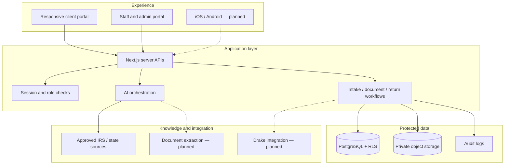
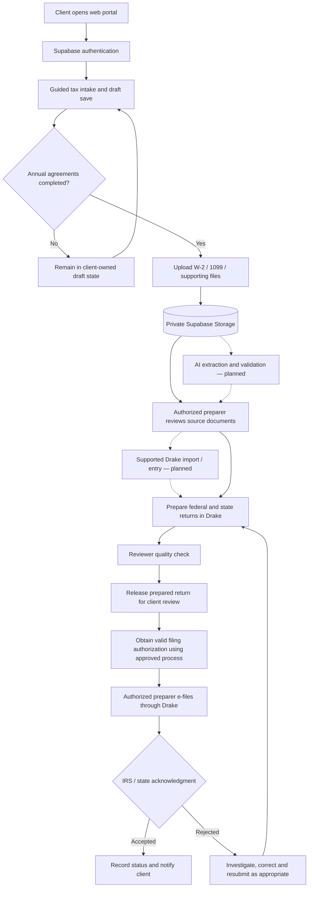
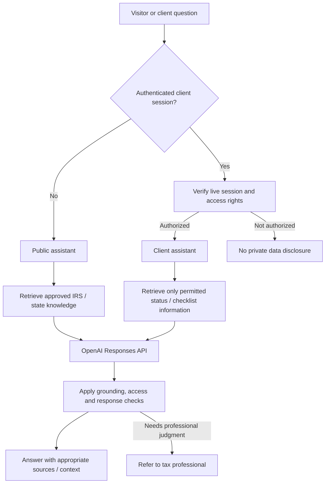
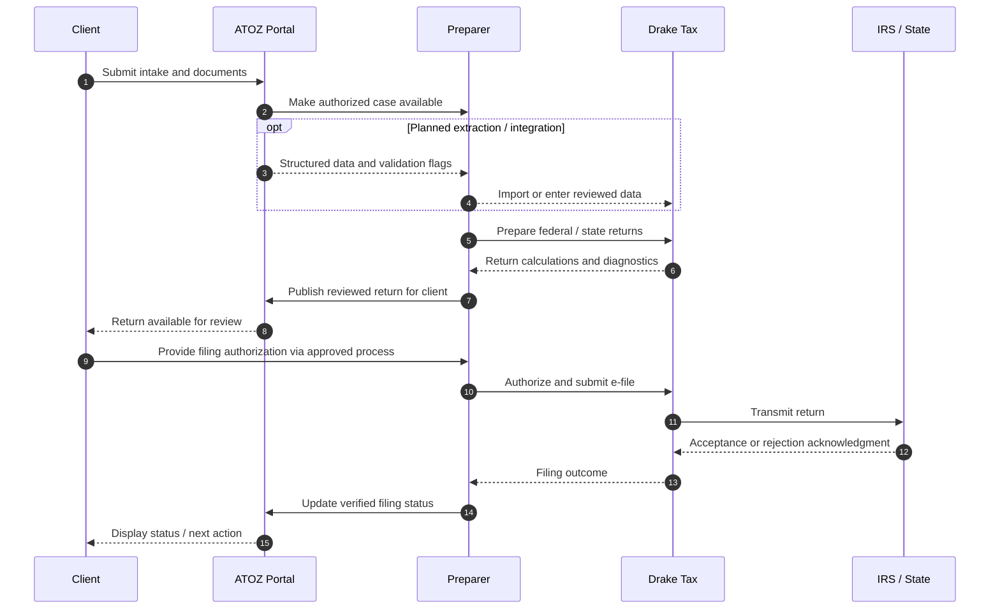

ATOZ E-File
Secure Tax Operations · AI-Assisted Workflows · Human Oversight
A full-stack and platform architecture case study for modern tax preparation
  
Project Website · [Architecture](docs/ARCHITECTURE.md) · [Security & Quality](docs/SECURITY_AND_TESTING.md) · [Engineering Case Study](docs/ENGINEERING_CASE_STUDY.md) · [AI & Mobile Roadmap](docs/ROADMAP.md)

Problem: Tax firms coordinate sensitive documents, client onboarding, preparer/reviewer assignments, and repetitive information entry across disconnected workflows.

Approach: Establish a secure, auditable workflow foundation, then introduce grounded AI and tax-software integrations with human review.

At a glance
	
Contribution	Solution architecture, full-stack implementation, database authorization, AI design, testing and release controls
Technology	Next.js 16 · React · TypeScript · PostgreSQL · Supabase Auth / Storage · OpenAI Responses API
Users	Tax clients · Preparers · Reviewers · Administrators
Current delivery	Active development; some features locally implemented and tested, others pending release
Future expansion	Document intelligence · Drake Tax integration · iOS and Android

Platform architecture

Conceptual architecture. Dashed edges indicate planned work, not shipped integrations.
End-to-end tax preparation data flow

Important: This diagram combines implemented components and a target-state workflow. Drake import, AI extraction, and e-file integration are planned. Remote Form 8879 signing is not currently enabled; a compliant, approved authorization process is required before e-filing. IRS/state acknowledgments are received through the authorized filing workflow, not inferred by AI.
How the ATOZ AI assistants work

AI design: Public tax information and private client-specific facts have separate access paths. The authenticated assistant must not use a public identity match alone as permission to disclose sensitive records. Document-grounded historical Q&A and automated extraction remain expansion work.
Phase 1 — Secure operations foundation
Client experience
- Five-step guided tax intake, draft save/resume and validation
- Spouse and dependent information, annual agreement workflow
- Private document upload, return progress and support
Staff operations
- Preparer/reviewer/admin roles and assignment-aware authorization
- Review and prepared-return release design
- Client/source vs. prepared document separation
- Audit evidence and status tracking
Delivery qualification: Some core features are implemented and locally tested. Hosted intake draft saving is blocked pending a reviewed database fix; annual agreement templates are not yet published; certain release controls depend on unapplied migrations. This is not represented as a fully released production platform.
Phase 2 — AI-assisted tax operations
- Public assistant: General tax-process answers grounded in approved official knowledge.
- Authenticated client assistant: Client-specific status and checklist guidance behind authorization boundaries.
- Planned document intelligence: W-2 / 1099 extraction, classification, prior-year comparisons and missing-document detection.
- Planned Drake Tax integration: Reduce duplicate entry without replacing established preparation and e-file workflows.
- Human-in-the-loop design: Preparers review consequential outputs; AI does not independently finalize or file returns.
Drake Tax and IRS filing lifecycle — target state
▶ Watch the animated filing workflow
[index.html](https://github.com/user-attachments/files/33743383/index.html)
<!DOCTYPE html><html lang="en"><head><meta charset="UTF-8"><meta name="viewport" content="width=device-width,initial-scale=1"><title>ATOZ E-File | Animated Tax Filing Workflow</title></head><body><main>

<h1>ATOZ E-File · Animated Filing Flow</h1>
Follow the proposed path from client intake to Drake Tax, IRS acknowledgement, and client notification.

Interactive architecture concept · Not a live filing integration
<section class="stage" aria-label="Animated sequence diagram"><svg id="chart" viewBox="0 0 1100 1020" role="img" aria-label="Sequence flow between Client, ATOZ Portal, Preparer, Drake Tax and IRS or State"><defs><marker id="arrow" markerWidth="7" markerHeight="7" refX="6" refY="3.5" orient="auto"><path d="M0 0 L7 3.5 L0 7Z" fill="context-stroke"/></marker></defs><g id="lanes"></g><g id="steps"></g><g id="moving"></g></svg></section>
<button id="play">▶ Play</button><button id="pause">Ⅱ Pause</button><button id="next">→ Next step</button><button id="reset">↺ Reset</button><label>Speed <select id="speed"><option value="0.5">0.5×</option><option value="1" selected>1×</option><option value="2">2×</option><option value="3">3×</option></select></label>
<strong id="current">Ready to play</strong><small id="detail">Press Play to see data move between systems.</small>

<i class="swatch" style="background:var(--blue)"></i>Client and portal<i class="swatch" style="background:var(--purple)"></i>Preparer review<i class="swatch" style="background:var(--amber)"></i>Planned Drake exchange<i class="swatch" style="background:var(--green)"></i>Filing response

<strong>Scope:</strong> This is a proposed operational workflow. Drake import automation, AI extraction, native mobile apps and filing orchestration are not represented as live. Filing authorization must be obtained using an approved process; remote Form 8879 signing is not enabled in ATOZ. An authorized preparer submits through supported Drake workflows. Acceptance or rejection must be verified before displaying a filing outcome.

This standalone HTML can be hosted with GitHub Pages. GitHub README files cannot execute embedded JavaScript; link to the hosted animation from your README.
</main></body></html>

Open the interactive data-flow animation →

Explore the proposed sequence from client document submission to preparer review, Drake Tax, IRS/state acknowledgment and client status updates. The interactive demo includes colored animated arrows, moving indicators, and Play / Pause / Next / Reset / Speed controls.
Publishing note: The animation opens on GitHub Pages after you enable Pages for this repository. GitHub's README cannot run JavaScript, so the static diagram stays visible below while the button opens the interactive version. This is a proposed workflow, not a live Drake connector or automatic filing system.

This is a proposed operational workflow, not a claim of an active automated Drake connector. Drake-supported import/export mechanisms and filing-status interfaces must be verified before implementation.
Mobile strategy — iOS and Android
Responsive web exists; dedicated native mobile apps are planned, not built. Both future apps would reuse central APIs, authentication, authorization and workflow logic. Planned features include camera document capture, intake progress, notifications, return tracking and authorized AI support.
Featured engineering decision
Allowing draft intake without weakening agreement requirements
Problem: The database blocked early draft saves because annual authorization checks were applied before the client reached the agreement step.

Design: Allow a live authenticated client to save their own draft while keeping final onboarding and staff processing agreement-gated. Preserve RLS, ownership, revoked-session protections and audit events.

Validation: Local security regression and workflow tests passed. The candidate fix has not been applied remotely; deployed baseline and recovery checks remain pending.

[Read the full case study →](ENGINEERING_CASE_STUDY.md)
Engineering depth
Engineering concern	Design response
Client isolation	PostgreSQL Row Level Security and owner-aware server checks
Staff permissions	Role and assignment-based authorization; review boundaries
Document security	Private storage, separated source/prepared artifacts
AI access	Public vs. authenticated assistants; source-grounded responses
Quality	Focused automated tests, browser workflows, TypeScript, lint, production build
Change management	Candidate migrations, read-only preflight, explicit deployment authorization
Build vs. integrate	Plan to integrate with Drake Tax rather than rebuilding filing infrastructure

Portfolio guide
Document	What it demonstrates
[Architecture](ARCHITECTURE.md)	Components, data boundaries, workflow and API patterns
[Security & Testing](SECURITY_AND_TESTING.md)	Defense in depth, quality gates, test evidence
[Engineering Case Study](ENGINEERING_CASE_STUDY.md)	Debugging, trade-offs, rollout discipline
[Delivery Roadmap](ROADMAP.md)	Implemented vs. pending vs. planned features

Build secure foundations. Automate responsibly. Keep professionals in control.

Architecture portfolio only. No taxpayer information, production secrets or internal deployment artifacts are included.

